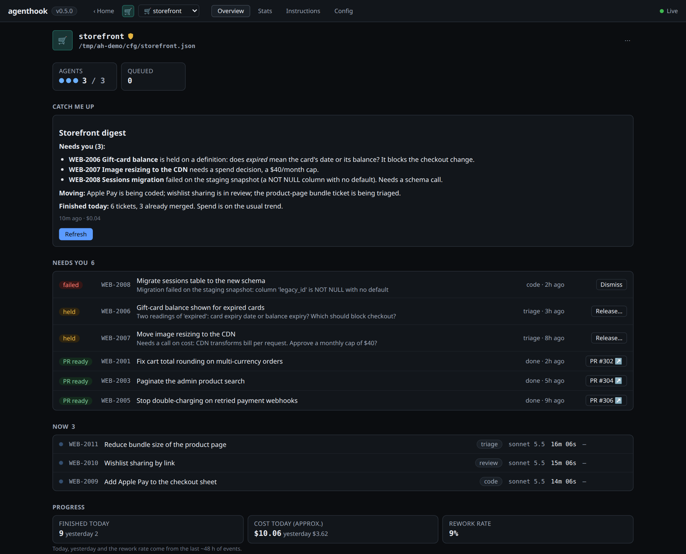
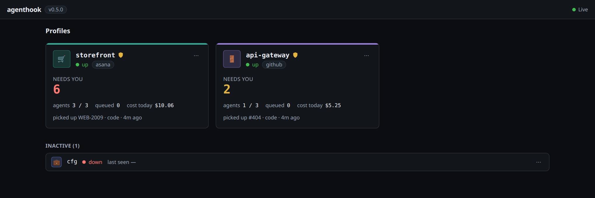
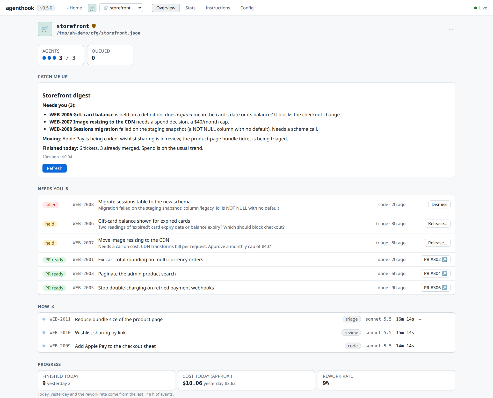
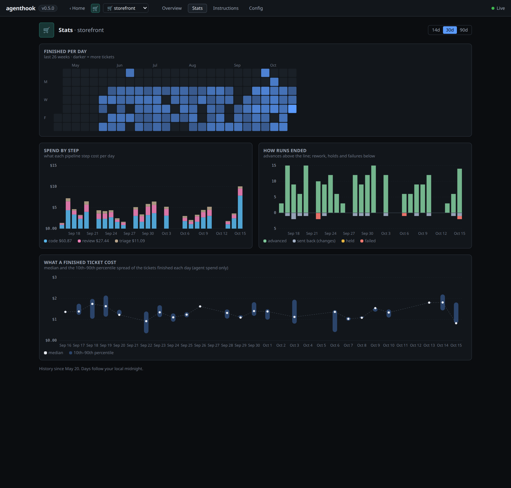
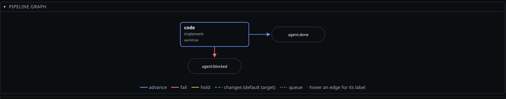
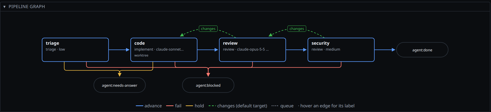
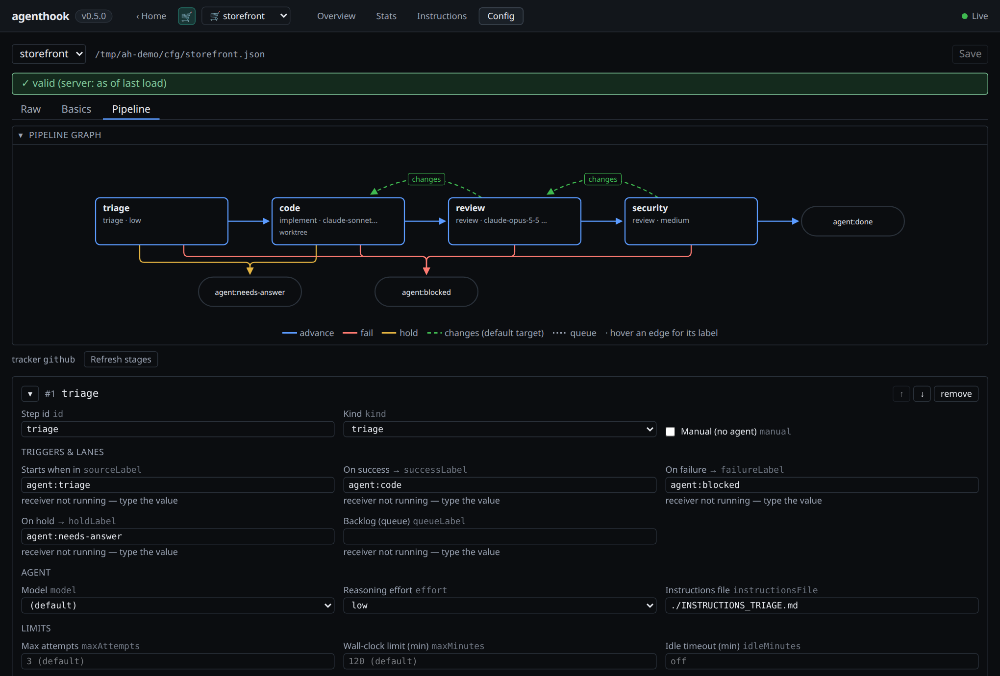

# agenthook

[](https://github.com/Jesuso/agenthook/actions/workflows/ci.yml)
[](https://www.npmjs.com/package/@jesuso/agenthook)

**Turn your task board into a team of coding agents.** Move a ticket into a column and a Claude
Code agent picks it up *the instant it lands*, works in its own git worktree, opens a draft PR,
and hands the ticket to the next stage — all while you do something else. agenthook is the
receiver, the pipeline and the dashboard that make that safe to leave running.



## What it solves

Running one coding agent in a terminal is easy. Running a *dozen tickets a day* through agents is
not, and the work moves from writing code to **supervising**: who is stuck, what needs my answer,
what is ready to merge, what is this costing me? agenthook handles the plumbing so your attention
goes only where a human is actually needed.

- **No babysitting.** The tracker already knows the moment a ticket moves, so it pushes a webhook
  and the matching stage starts. No polling loop, no cron, nothing spinning while you're idle.
- **A real workflow, not one big prompt.** You define a **pipeline** of stages (say triage → code →
  review), each with its own standing instructions. An agent ends a stage with a **verdict**:
  advance, send back for rework, *hold* to ask you a question, or fail. The receiver moves the
  ticket accordingly; the rework loop is capped so it can't spin forever.
- **Parallel and isolated.** Every ticket gets its own git worktree, so several agents work side by
  side without colliding. One receiver per project, any number of projects at once.
- **Your attention, boiled down.** The web UI shows what **needs you** (held questions, failures,
  PRs waiting to merge), what is **running now**, and how the day is going — one project at a time.
- **Works with the tools you have.** Asana, Jira, GitHub Issues and GitHub Projects v2 today;
  ngrok or your own HTTPS endpoint for ingress. Each is one small adapter, so more are easy to add.

```
 move to a stage         webhook POST            route to step        headless `claude -p`
 on your board    ─────▶  receiver (verify)  ──▶  dedup + queue   ──▶  branch + draft PR
                                                                        → advance to next stage
```

## What it looks like

`agenthook ui` opens a local dashboard (127.0.0.1 only, token-protected, nothing to configure).

**Home** — one card per project: how many things need you, how many agents are busy, today's
spend, and the last thing that happened.



**Overview** — the page you keep open. *Catch me up* writes a short briefing in the voice you
define; **Needs you** lists every ticket blocked on a human, each with its one action (answer a
held ticket, dismiss a failure, open the PR); **Now** shows live agents; **Progress** keeps score.
It follows your system's light or dark theme.



**Stats** — your whole history: a calendar heatmap of finished tickets, spend per pipeline step,
how runs ended (advanced, sent back, held, failed) and what a finished ticket really costs.



Also in the UI: a live log viewer for every agent run, an editor for the per-step instruction
files and the config (with validation and backups), and profile identity (colour + emoji) so
several projects stay distinguishable at a glance. Details in [docs/web-ui.md](docs/web-ui.md).

## Capabilities

| | |
|---|---|
| **Pipeline** | Ordered stages bound to Asana sections, Jira statuses, GitHub labels or Projects v2 columns; verdict-driven routing with hold and rework lanes |
| **Agents** | Headless `claude -p` per stage in a receiver-owned worktree, or [Cursor / Hermes / OpenCode](docs/agents.md) per step (`agent`); per-stage instructions; token and cost tracking (`agenthook usage`) |
| **Human in the loop** | Held tickets wait for your answer (`@agent` comment or **Release…** in the UI); failures and unmerged PRs surface as **Needs you** |
| **Forge** | Optional GitHub forge: PR merge detection, red-CI handling, mergeability and CI roll-up |
| **Multi-profile** | Many projects in parallel, each its own config, state and port; rename, move and archive profiles safely |
| **Multi-repo** | Route tickets of one board to different repositories |
| **Epics** | Group tickets into epics (Asana custom type, GitHub issue type or label + sub-issues — labels or Projects v2 —, Jira's native epic + parent) — progress, needs-you, velocity/ETA in the [UI](docs/github-setup.md#epics), MCP and CLI |
| **Briefings** | `ah digest` / **Catch me up**: a tool-less agent summarises one profile from a read-only snapshot |
| **Agent interface** | An MCP server and `tick`/`watch` commands so an engineering-manager loop can supervise and drive the pipeline |
| **Safety** | `fullAuto` off by default, HMAC-verified webhooks, fail-closed assignee scoping, optional [sandbox container](docs/sandbox.md) |

Two swappable axes, the engine blind to both: a **tracker** (where work comes from) and an
**ingress** (how the receiver is reachable). Adding another stage-based tracker or tunnel is one
adapter file ([docs/providers.md](docs/providers.md)). The architecture and the honest trade-offs
of push delivery are in [docs/architecture.md](docs/architecture.md) — agenthook ships a targeted
replay (`catchup` / `reconcile`) for the gaps.

> [!WARNING]
> **agenthook turns a webhook into code execution on your host.** With `fullAuto` enabled it runs
> `claude -p --dangerously-skip-permissions` — a verified webhook leads straight to *unsandboxed*
> command execution, gated only by the HMAC signature and a non-guessable URL. `fullAuto` is **off
> by default** (agents prompt for permission). Turn it on only on a trusted host with a scoped
> token, ideally inside the [sandboxed container](docs/sandbox.md) (the blessed `fullAuto` path —
> only the repo mounted). Read the full threat model in
> [docs/architecture.md#security-posture](docs/architecture.md#security-posture) and report issues
> per [SECURITY.md](SECURITY.md) before you point this at anything real.

## Build your pipeline, small first

A pipeline is just an ordered list of stages in the config — as many as you want. Start with a
single `code` stage, watch it work, then add stages as you get comfortable: a `triage` stage that
asks questions before any code is written, a `review` stage that sends work back, a security pass.

**Day one — one stage:**



**Later — triage, code, review, security:**



Every stage has its own standing instructions, optional model and reasoning effort, attempt and
time limits, and where a ticket goes on success, failure or hold. The config editor draws the
graph as you type and validates before it saves.



Stage-by-stage setup for your tracker is in the [Getting Started guide](docs/getting-started.md#4-map-your-sections-to-steps--the-part-that-actually-matters);
every field is in [docs/configuration.md](docs/configuration.md).

## Install

Requires Node ≥ 22, the [`claude` CLI](https://claude.com/claude-code), `git`, and — for the
ngrok ingress — [`ngrok`](https://ngrok.com). Plus a tracker API token.

```bash
npm i -g @jesuso/agenthook   # installs the `agenthook` command; or run ad-hoc with `npx @jesuso/agenthook <cmd>`
```

## Quickstart

> **New here? Follow the [Getting Started guide](docs/getting-started.md)** — it walks the full
> path end to end, including the two manual steps below (finding section gids, writing the
> instruction files) that this overview compresses.

agenthook is a tool you run *inside the project you want agents to work on* — its config lives
there like a `tsconfig.json`, while runtime state lives centrally in `~/.agenthook/<name>`.

```bash
cd ~/my-project

agenthook init            # interactive: pick tracker + ingress, fetches your
                          # workspace/project so you choose from a list
                          # → writes ./agenthook.config.json (with TODO_* section gids)

$EDITOR .env              # add your ASANA_TOKEN or JIRA_API_TOKEN (init prints which vars)

# Fill in the pipeline — replace the TODO_* section gids and write the per-step
# instruction files. THIS step is required; doctor won't catch missing gids.
$EDITOR agenthook.config.json      # see Getting Started §4
cp INSTRUCTIONS.example.md INSTRUCTIONS_CODE.md

agenthook doctor          # preflight: token resolves, repo is git, port free, …
agenthook start           # ingress up → register webhook → serve
```

`init` offers an optional `ah` shortcut (a symlink beside the `agenthook` bin) so you can type
`ah start`, `ah agents`, … — add or remove it later with `agenthook alias [--remove]`. It's opt-in
and never overwrites an existing `ah` on your PATH.

Move an item you're **assigned** into your pipeline's first stage — a section (Asana), status
(Jira), label (GitHub Issues), or Status column (GitHub Projects v2) → a run appears under
`~/.agenthook/<name>/logs/`. Watch it live with `agenthook follow`. Stop with
`agenthook stop`. If nothing fires, the [troubleshooting guide](docs/troubleshooting.md) is
symptom-first.

`init` writes secrets as `${ENV}` **references**, never literal values, so the config is safe to
commit or share — the actual tokens stay in `.env` (gitignored) or your shell.

## Documentation

- **[Getting Started](docs/getting-started.md)** — install → token → pipeline → first run, end to end
- [Asana setup](docs/asana-setup.md) · [Jira setup](docs/jira-setup.md) · [GitHub Issues setup](docs/github-setup.md) · [GitHub Projects v2 setup](docs/github-projects-setup.md) — token + board specifics
- [Web UI](docs/web-ui.md) — the `agenthook ui` dashboard: Home, Overview, Stats, editors
- [Profiles](docs/profiles.md) · [Configuration & ingress](docs/configuration.md) · [Operating agents](docs/operating.md) — day-to-day reference
- [Troubleshooting](docs/troubleshooting.md) — symptom → fix
- [Architecture](docs/architecture.md) — how the engine works + the honest tradeoffs
- [Security posture](docs/architecture.md#security-posture) · [Sandbox](docs/sandbox.md) — running `fullAuto` safely
- [Providers](docs/providers.md) — add a tracker or ingress adapter
- [Agent interface (MCP)](docs/mcp.md) · [Agent guide](docs/agent-guide.md) — let an EM loop or Claude Code session read and manage the pipeline

## Profiles & parallel runs

A **profile** is one config = one process = one isolated state dir (`~/.agenthook/<name>/`). Run as
many side by side as you like — nothing is shared. `agenthook ls` shows them all; `agenthook
status <name>` shows one in detail; rename, move, or archive a profile without losing its history.
Full guide: **[docs/profiles.md](docs/profiles.md)**.

## Ingress and configuration

`ingress.type` decides how the webhook reaches the receiver: **`ngrok`** (managed tunnel, zero
setup) or **`hosted`** (your own stable HTTPS URL, best for production). The config file holds
non-secret wiring plus `${ENV}` secret refs; `init` writes it for you and `agenthook ui` edits it
with validation and backups. Every field and both ingress types are documented in
**[docs/configuration.md](docs/configuration.md)**; start from
[`agenthook.config.example.json`](agenthook.config.example.json).

## Starting work and operating agents

Work starts when a ticket **enters a stage's inbox** (a section, status, label or board column).
`agenthook run <ref>` injects a backlog item; `catchup` / `reconcile` replay items missed while the
receiver was down. Running agents are plain `claude -p` processes: list them with
`agenthook agents`, tail one with `agenthook follow`, see tokens and cost with `agenthook usage`,
and tear down finished worktrees with `agenthook cleanup`. Details:
**[docs/operating.md](docs/operating.md)**. To drive the pipeline off the event bus instead of
polling, see [Event-driven delivery loop](docs/operating.md#event-driven-delivery-loop).

## Let other agents run it (MCP)

An engineering-manager loop or any Claude Code session can see and manage the pipeline without
writing its own polling script:

```bash
claude mcp add agenthook -- agenthook mcp              # read + write, all profiles
claude mcp add agenthook -- agenthook mcp --read-only  # watcher that can never act
```

Tools: `tick` (status + board + PRs + new events in one call), `status`, `events` (blocks until
something happens, no polling), `runs`, `board`, `prs`, `guide`, and — unless `--read-only` — `run`,
`cancel`, `release` (answer a held ticket), `pause`/`resume`, `set_concurrency`, `reconcile`,
`pull`, `restart`. Calls are token-thrifty (`etag`, event cursors). No MCP client? `agenthook tick`
and `agenthook watch` give shell agents the same data (`--all` or several names: every profile in
one call, one wake-up). Write tools hand operator authority to the
agent that holds them — read [docs/mcp.md](docs/mcp.md#safety) first. Agents learn the tools from
the `guide` tool ([docs/agent-guide.md](docs/agent-guide.md)); a ready-made Claude Code skill is in
[`examples/skills/agenthook-supervisor`](examples/skills/agenthook-supervisor/SKILL.md).

## Safety

agenthook ships **locked down**: `fullAuto` is off by default, so agents run a permission-gated
`claude -p` and prompt before acting. Enabling `fullAuto` opts into
`claude -p --dangerously-skip-permissions` — then a verified webhook leads straight to code
execution on your host, gated only by the HMAC signature + a non-guessable URL, and it is **not**
sandboxed. Even with `fullAuto` on, agents branch off the default branch, open *draft* PRs, and
ask rather than guess. Run on a trusted host, scope the token, stop the tunnel when idle, and
prefer the [sandboxed container](docs/sandbox.md) with only the repo mounted. Full posture in
[docs/architecture.md](docs/architecture.md#security-posture); disclosure process in
[SECURITY.md](SECURITY.md).

## How it works

- **Two blind axes.** The engine names neither tracker nor tunnel; `src/trackers/*` and
  `src/ingress/*` adapters own all platform specifics behind one interface each.
- **Server owns ingress.** `start` brings the tunnel up, registers the webhook (scrubbing
  stale hooks when the URL is ephemeral), serves, then tears down on exit.
- **Fast ACK, async work.** Verify synchronously, ACK in <10s (providers retry otherwise),
  then dispatch off the response path.
- **Dedup.** Providers deliver at-least-once; a per-event `seen` set keeps one event → one run.
- **Worktree isolation.** Parallel agents never collide; each gets its own worktree.
- **Verdicts, not exit codes.** Each agent writes a verdict (`advance`/`hold`/`changes`/`fail`) the
  receiver reads to route the task. The `changes` rework loop (e.g. review → code) is capped so it
  can't spin forever; a crash always means `fail`.

Details: [docs/architecture.md](docs/architecture.md) · [docs/providers.md](docs/providers.md) ·
[docs/agenthook-v2.md](docs/agenthook-v2.md)

## Contributing & community

Issues, ideas, and PRs all welcome — agenthook is dependency-light and built to be hacked on.

- 🛠 **[CONTRIBUTING.md](CONTRIBUTING.md)** — dev setup, the local CI gate, and a step-by-step guide
  to writing a new tracker/ingress adapter (the most common contribution).
- 💬 **[Discussions](https://github.com/Jesuso/agenthook/discussions)** —
  [Q&A](https://github.com/Jesuso/agenthook/discussions/categories/q-a) for setup help,
  [Ideas](https://github.com/Jesuso/agenthook/discussions/categories/ideas) for features.
- 🐛 **[Issues](https://github.com/Jesuso/agenthook/issues)** — reproducible bugs (start with
  [`good first issue`](https://github.com/Jesuso/agenthook/labels/good%20first%20issue)).
- ❤ **[Sponsor](https://github.com/sponsors/Jesuso)** — if agenthook saves you time.

By participating you agree to the [Code of Conduct](CODE_OF_CONDUCT.md).

## License

MIT
