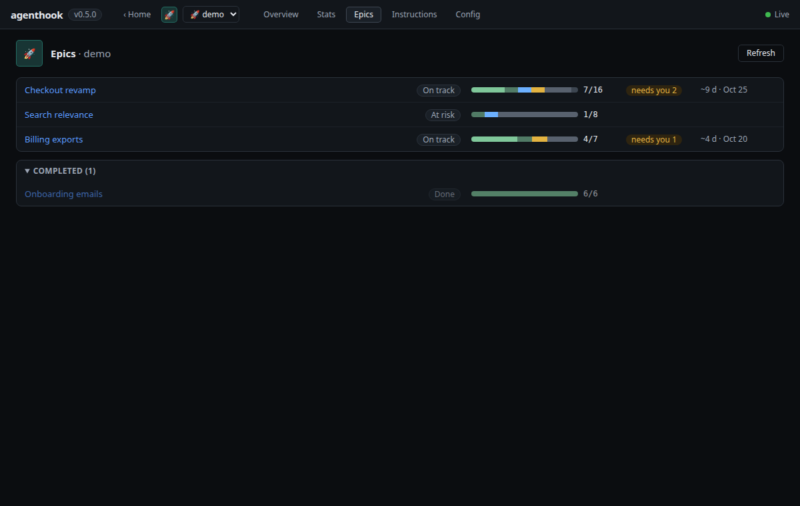
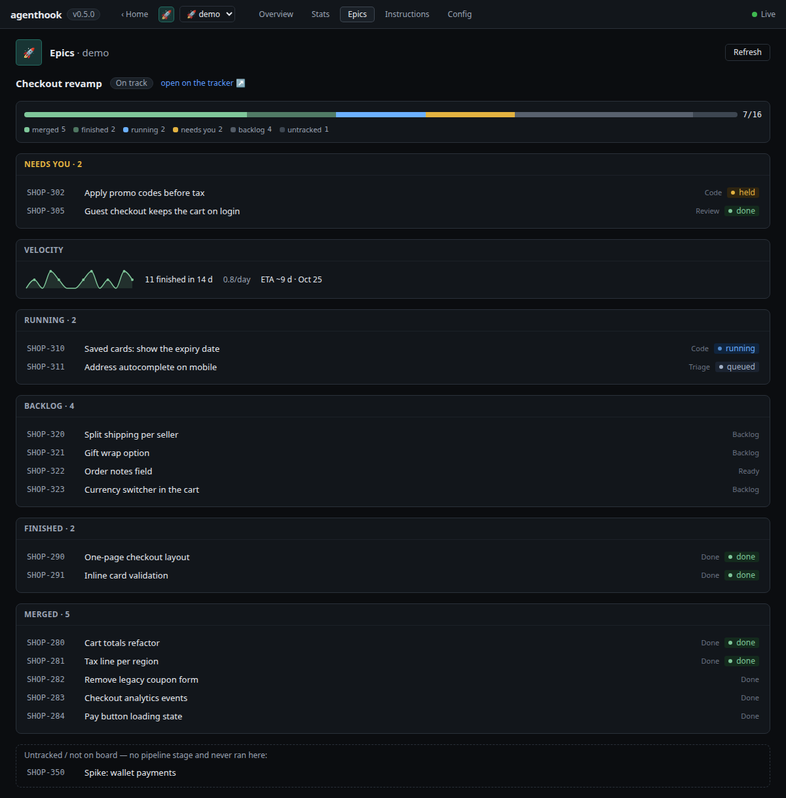

# Web UI — design plan

Status: **planned** (epic tracked on GitHub). v1 is a read-only proof of concept.

A local web dashboard for agenthook: see every profile, how many agents are working, what each
ticket is doing (with links to the ticket on its tracker and to its PR), and — in later phases —
review and edit the pipeline config and each step's instructions markdown with a real editor.

Inspiration: OpenClaw's Control UI (schema-driven config form + raw JSON editor) and Hermes Agent's
`hermes dashboard` (local web server, localhost by default). We take the ideas, not the
complexity: no remote access layer, no secrets management, no hosted service. Fully open source.

## Decisions

| Topic | Decision |
|---|---|
| Scope | **One UI for all profiles** under `~/.agenthook/` (same discovery as `ah ls`). |
| Access | **Localhost only.** No remote / tailnet / tunnel access. |
| Secrets | **Never.** The UI edits config files only; `${ENV}` refs are shown as refs, never resolved. `.env` is not read or written. |
| v1 | **Read-only.** Editing lands in v2 (instructions) and v3 (config). |
| Look & feel | **Dense ops console**: tables, monospace for ids/paths, dark-first (light supported). Built to sit on a second screen. |
| Node | Raise `engines` to **Node ≥ 22** (Node 20 is EOL as of 2026-04). |
| Realtime | **No polling.** `fs.watch` (inotify/FSEvents/kqueue) → Server-Sent Events. No socket.io (adds a dep and falls back to long-polling). |

## Why a separate process, not the receiver's port

The receiver's port is what the ingress (e.g. ngrok) tunnels to the internet. Anything served there
is reachable by anyone who has the webhook URL. And editing step instructions is editing what an
unsandboxed `claude -p` runs under `fullAuto` — the editor is an RCE-grade surface.

So the UI is its own command and process:

```
ah ui [--port 4180] [--no-open]
```

- Binds **127.0.0.1** only. No flag to bind elsewhere.
- Generates a random token per launch and opens `http://127.0.0.1:4180/?token=…` (Jupyter-style);
  the token is exchanged for an `HttpOnly; SameSite=Strict` cookie. Every API call requires it.
- Rejects requests whose `Host` isn't `127.0.0.1:<port>`/`localhost:<port>` (DNS-rebinding) and,
  for writes (v2+), whose `Origin` doesn't match (CSRF).
- Is a **blind reader** of the state dirs. It never writes receiver-owned runtime state
  (`running.json`, `queue.json`, `held.json`, `seen.json`, …). In v2+ it writes only files the user
  owns: `agenthook.config.json` and the `instructionsFile`s it references. The one state-dir move
  it makes is archiving a **stopped** profile on Remove… (v3, below), via `src/archive.js`.

## Data sources (v1 needs almost no engine change)

Everything lives in `~/.agenthook/<profile>/`:

| UI shows | Source |
|---|---|
| Profiles, up/down, port, ingress, fullAuto | `heartbeat.json` + pidfile (`listProfiles`/`readProfile` in `src/heartbeat.js`) |
| Agents working / queued | `heartbeat.queue`, `running.json`, `queue.json` |
| Held items + reason | `held.json` |
| Ticket display id, title, PR number | `refmeta.json` (already written by `dispatch.js`) |
| Timeline, outcomes, cost | `events.jsonl` (append-only; `run_end.costUsd`) |
| Run logs / sessions | `logs/`, `src/sessions.js` (`recentRuns`, `listSessions`) |

### Engine changes required

1. **Tracker URL in `refmeta`.** `refmeta` has `displayId`/`title`/`pr` but no link. Cache
   `task.url` alongside them at dispatch so every ticket row links to its tracker from its first run.
2. **PR URL.** With a `forge` block (or a `github` tracker), build
   `https://github.com/<repository>/pull/<pr>` from the cached number — no API call. Without one,
   show the PR number only.
3. **`control.sock` — instant liveness.** A crashed receiver writes nothing, so a stale heartbeat
   is indistinguishable from a quiet one without polling the pid. The receiver listens on
   `~/.agenthook/<profile>/control.sock` (a named pipe on Windows); the UI server connects, and a
   closed connection marks the profile down immediately. v1 uses it **only for liveness**; later
   write actions (catchup, cancel, restart-when-idle) go over this socket rather than by editing
   engine-owned files.

## Realtime model

```
disk change ──fs.watch──► ui server ──SSE──► browser
browser edit ──POST {path, baseHash, content}──► atomic write ──► fs.watch ──► SSE to all tabs   (v2+)
```

- `GET /api/snapshot` → full state on connect. `GET /api/stream` (SSE) → typed deltas. The browser
  `EventSource` reconnects by itself and re-fetches the snapshot on reconnect.
- `ProfileView.recentCosts` → `{at, costUsd, estUsd}[]`: the `run_end` events with a reported cost
  or a rate-table estimate (`src/pricing.js` `costOf`, the heartbeat's `pricing` overrides) from
  the last 48 h of the profile's events tail, oldest first; the field that doesn't apply is 0.
  Tiles show `$x + ~$y est.`, never one blended sum. The dashboard's "cost today (approx.)"
  tile buckets them by the browser's local midnight — approximate because the tail is
  byte-bounded (256 KB). A new `run_end` re-emits the profile over SSE.
- `ProfileView.paused` (the operator pause, `heartbeat.paused`) and `ProfileView.restartPending`
  (`heartbeat.restartPending || decommissionPending || draining` — something already holds the
  queue) are booleans while the receiver is up and `null` when it's down, like `active`/`queued`:
  a dead heartbeat keeps its last flags. They back the dashboard row's Paused pill and its
  Restart when idle / Pause new runs / Resume actions (below).
- Run-log viewer: `GET /api/runs?profile=&ref=` → `{ runs: RunView[] }` listed straight from the
  profile's `logs/` (outcome/cost/`estUsd`/`costBasis`/`endedAt` joined from `run_end`; `endedAt` = its `ts`, `null`
  while running or once it aged out of the events tail). `GET /api/log/stream?profile=&run=` (SSE)
  → `init` (last ≤ 64 KB from a line boundary), `append`, `reset` — a per-connection `fs.watch` on
  the `logs/` dir, closed with the connection. `run` must be a run-log basename actually listed in
  `logs/` whose realpath stays there; anything else is `404`.
- **Watch directories, not files.** `heartbeat.json` and friends are rewritten (and atomic writes
  rename over the inode), so a file-level watch dies. Watch the state dir and filter by name.
- **Debounce + hash.** `fs.watch` emits duplicates/out-of-order; debounce ~50 ms, re-read, compare a
  content hash, broadcast only on real change.
- **Tail `events.jsonl` by byte offset** — read only the appended bytes, never the whole file.
- **Never `fs.watchFile`** — it is stat-polling.
- **v2 conflicts.** Writes carry `baseHash`; a mismatch returns `409` and the UI shows
  "changed on disk — reload / diff / overwrite". The server remembers the hash it just wrote to
  suppress its own echo.

## The ticket row (view model)

One merged record per ref, built server-side from `running` + `queue` + `held` + `refmeta` +
recent `events`:

```ts
type TicketRow = {
  profile: string;
  ref: string;
  displayId: string;          // refmeta.displayId, else ref
  title: string | null;
  step: string | null;        // current / last step id
  status: 'running' | 'queued' | 'held' | 'failed' | 'cancelled' | 'done' | 'idle' | 'interrupted' | 'stalled';
  model: string | null;       // from run_start
  startedAt: string | null;
  costUsd: number;            // sum of run_end.costUsd (reported)
  estUsd: number;             // sum of rate-table estimates (runs with no reported cost); shown "~$x est."
  trackerUrl: string | null;  // refmeta.url
  prUrl: string | null;       // derived from refmeta.pr + forge repository
  heldReason: string | null;
};
```

When the owning profile is down, `running` reads as `interrupted` and `queued` reads as
`stalled` — the receiver isn't live to finish or drain those jobs (it resolves them on its next
boot: `recoverInterrupted()` / `restoreQueued()`).

A `failed` event whose reason is `cancelled by operator` reads `cancelled` (not counted by the
"needs you" tile). A `failed`/`cancelled` row has a **dismiss** button: `POST /api/dismiss`
(`{profile, ref}`, the same guard chain as restart) asks the receiver over `control.sock` to write
a `dismissed` event, after which the row reads `idle`. The receiver — not the UI server — writes
it, and refuses a running, queued or held ref. A later run or failure of the ref counts again.

A `failed` row's primary action is **Re-run** while the receiver is up: `POST /api/retry`
(`{profile, ref}`, same guard chain) sends the receiver's `retry` op, which re-enters the failed
step's source stage. It never reassigns, and refuses a ticket that is not failed or not ours. With
the receiver down the row offers **Open log** instead (the drawer, with the full failure reason).
Dismiss stays as the quieter secondary action.

## Stack

| Layer | Choice | Why |
|---|---|---|
| UI server | `src/ui/` — plain `node:http`, **JSDoc-typed JS**, zero runtime deps | Matches the core; runs unbuilt. Node refuses to strip `.ts` under `node_modules`, so server-side TS would break `npm install`ed copies. |
| Frontend | `ui/` — **TypeScript + React + Vite + Tailwind** | Real TS where a build step exists anyway; the stack agents write most fluently. Bundle size is moot for a local tool. |
| Editor (v2) | CodeMirror 6, markdown mode + split preview | MIT, light; Monaco is too heavy. |
| Shared contract | `src/ui/contract.js` (JSDoc typedefs: snapshot, SSE events, `TicketRow`) | The frontend `import type`s it, so server and browser can't drift. |
| Tests | `node:test` for the server (watcher, debounce, row builder, auth); Vitest for frontend logic | Same zero-dep core runner; Playwright smoke later. |

Dependency policy:
- The core keeps **zero runtime deps**. UI libraries are `devDependencies` only, shipped as a
  prebuilt bundle (`ui/dist`, in npm `files`).
- `ui/dist` is **not committed**; it is built in CI and in `prepublishOnly`. In a dev checkout,
  `ah ui` with no bundle exits with "run `npm run build:ui`". A bundle older than `ui/src` (a
  `git pull` that touched the frontend with no rebuild) is not fatal: `ah ui` warns and still
  serves the stale bundle; `ah doctor` warns (⚠, not a failure).
- Licenses restricted to MIT / Apache-2.0 / BSD / ISC, enforced in CI.

## Phases

### v1 — read-only dashboard (the PoC)

- `ah ui` server: auth token, host checks, snapshot + SSE, directory watcher, events tail.
- Engine: tracker URL in refmeta; `control.sock` liveness.
- Frontend: profiles overview (up/down, agents running/queued, fullAuto badge), tickets table with
  tracker + PR links, live event feed, read-only run-log viewer (live tail of the active run).

**Done when:** every live profile appears with its agent count; tickets update live with working
tracker and PR links; event feed and log viewer work; a state-file change reaches the UI in
< 100 ms; no polling anywhere (no `setInterval` fetches, no `fs.watchFile`).

### v2 — instructions editor

The first phase that **writes**. Scope: the markdown files the pipeline uses as standing
instructions — each step's `instructionsFile`, the profile default `instructionsFile`, and each
repo's `instructionsFile`. Nothing else is writable.

**Edits are live.** `dispatch.js` re-reads instructions at every spawn, so a save takes effect on
the next agent run with no restart — including later steps of tickets already in flight. The
save flow says so and shows how many agents are running on steps that use the file.

**Which files (receiver → heartbeat).** `ah ui` loads no config and never resolves `${ENV}`, so the
receiver publishes what it already resolved at boot: `configPath` and an `instructions` list of
`{ path, scope: 'step'|'default'|'repo', ids[] }` (absolute paths). That list is the **only**
write allowlist.

**Write guards** (`PUT /api/instructions/file`):
- Cookie auth + `Host` check (as v1) + **`Origin` must equal the server origin** + required
  custom header `X-AH-UI: 1` + `Content-Type: application/json` (forces a CORS preflight that
  no other origin passes). Body capped at 256 KB.
- Target must match an allowlisted path exactly, exist, be a regular file (no symlink — `lstat`),
  end in `.md`, and realpath to itself.
- Optimistic concurrency: the request carries `baseHash` (sha256 of the content the editor
  loaded); a mismatch returns `409` with the current content + hash. No blind overwrite.
- Atomic write: temp file in the same dir with the original mode → fsync → rename. The previous
  content is kept as a one-generation backup in the profile's state dir
  (`~/.agenthook/<profile>/instructions-bak/`, 0600) — never beside the file, where a `.bak` would
  escape the repo's `INSTRUCTIONS*.md` ignore rules.
- Every save is appended to a UI-owned `~/.agenthook/<profile>/ui-audit.jsonl`
  (`{ts, path, oldHash, newHash, bytes}`) — the only state-dir file the UI writes.
- External edits (your `$EDITOR`) reach open tabs as SSE `instructions` events (dir watch +
  hash), and the server suppresses the echo of its own write.

**"What the agent sees" preview — from the last real prompt.** An exact preview needs the ticket,
and fetching it needs tracker credentials the UI must not hold. Instead the receiver saves every
run's assembled prompt beside its log (`<log>.prompt.md`, mode 0600). The preview takes the step's
most recent prompt, splits it at `=== TICKET ===`, and substitutes the editor's live buffer for
the standing part (repo instructions + step instructions, in dispatch order). Exact, credential-free,
no control-socket commands. A step that never ran previews the standing part only.

**Editor UX.** CodeMirror 6 (markdown), rendered preview via `react-markdown` (no raw HTML),
`@codemirror/merge` diff shown before every save, unsaved-changes guard, "changed on disk —
reload / diff / overwrite" banner on 409 or an external edit.

### v3 — config editor

Edits `agenthook.config.json` — the one file at the receiver-published `heartbeat.configPath`.

**Shipped so far:** the **Config** tab's raw JSON editor (live parse check, server errors and
literal-secret warnings, diff → confirm with a second ack for changed sensitive fields — secret
values masked — guarded `PUT /api/config`, reload/diff/overwrite banner) and **Restart when idle**
after a save, its banner driven by SSE (`restart_requested` → `restarting` → a new pid), and the
**Basics** / **Pipeline** / **Tracker** / **Forge** / **Ingress** / **Integrations** / **Repos**
form tabs beside Raw (one shared
buffer; every change a `jsonc-parser` edit, reorder swaps the steps' exact text) with **stage
pickers** fed by `GET /api/discover` on first form-tab open and on Refresh, and a collapsible
**pipeline graph** panel above every pane, re-deriving from the live buffer on every edit — form or raw text — without
a save; an unparseable buffer shows "fix the JSON to see the graph" instead.
**Revert** beside Save throws a dirty buffer back to the loaded/saved text (works on broken JSON; on
a conflict the buffer goes clean and the newer disk version reloads).

**Confirms.** Every "are you sure?" in the Config and Instructions editors and the leave-a-dirty-view
guard is the in-app `ConfirmModal` (`ui/src/Modal.tsx`: `role="alertdialog"`, focus on Cancel, Tab
trapped, Escape closes only the topmost dialog). `beforeunload` is the only native prompt left.

**Reading order.** The tabs read **Basics · Pipeline · Tracker · Forge · Ingress · Integrations ·
Repos · Raw**; a config that parses opens on **Pipeline** with the graph expanded (an unparseable one still falls back to Raw, the form tabs
disabled with "fix the JSON in Raw first"). Raw stays the escape hatch — nothing forces a hand edit.
Every Pipeline stage card starts **collapsed** to its header: `#n`, the step id and a one-line
summary (`summarizeStep`) — `kind · <source> → <success> / <failure> · manual · worktree · drain ·
<model> · <effort>`, each part omitted when absent, lanes as the discovered stage names (the raw
value without a list), model / effort only when the step overrides them. "+ Add step" opens the new
card; **Expand all** / **Collapse all** sit beside Refresh stages. Errors are attributed per step
(`stepErrors` in `configEdit.ts`: the client checks by index — a duplicate id on the later step —
plus the server's by `tracker.pipeline[i]` or `pipeline step "<id>"`; anything else stays only in
the panel above): an errored card gets a red badge and its errors inline, and opens itself when
the error appears (collapse it again and the badge stays). Collapse / expand and graph clicks are
view state only; they never touch the buffer.

**Card errors and Save.** An error a card on the open pane renders (`cardFor` in `configEdit.ts`:
a sink, a repo — when it names only that one — or a step) is not repeated in the banner row: the
first other problem leads it, or, with none left, the row reads "N problem(s) — see the highlighted
cards" (the overlay keeps the full list). On Raw, or a pane without that card, the row lists it as
before. A just-added sink / repo / step card is **incomplete** until a field in it is blurred: its
errors render amber (`data-incomplete`), not red, and the banner is amber while every problem is
such a hint. ↑/↓/remove, a load or reload, Revert and any Save attempt end that grace. While the
client checks fail, Save is `aria-disabled` ("Fix N problem(s) first"): a click or Mod-s opens no
confirm and sends nothing, but turns every incomplete hint into a normal error. Server errors alone
never block Save. `closeIssue` / `completeTask` show only on the last step, a manual step, or a
step that already sets them — they act when a task enters that step.

**Tracker / Forge / Ingress tabs.** Rendered from the config schema (`src/config-schema.js`): each
tab lists its section's entries whose `scope` includes the active `tracker.type` (or has none) —
a new scoped schema entry adds a field — with the `advanced` ones in a collapsed "Advanced · N set".
`tracker.type` is read-only once set (every step's stage keys depend on it; change it in Raw) and a
picker only while absent; unchecking `assigneeFilter` carries an inline warning. The default-`true`
booleans (`tracker.assigneeFilter`, `forge.redCi`, `forge.greenCi`) show their effective value —
absent reads checked; unchecking writes an explicit `false`, checking again removes the key. The
**Forge** tab offers "Add GitHub forge" (`{"type":"github"}`) when there is no block and "Remove
forge block" (confirmed) when there is; `forge.ciTarget` picks among the **agent (non-manual)
pipeline step ids** — the rule `loadConfig` enforces — its default option naming the
`createsWorktree` step an unset target bounces to, and a manual/unknown current value stays
selectable but flagged. The **Ingress** tab reads an absent block (or type) as `manual`; `ngrok`
shows `authtoken`, `domain` (unset = a new URL every start) and advanced `webAddr`, `manual` /
`hosted` show `url`. Switching type only changes the visible fields — the other type's keys stay in
the file.

**Secret fields** (`tracker.token`, `tracker.webhookSecret`, `forge.token`, `forge.webhookSecret`,
`ingress.authtoken`, `sinks[*].url`, `sinks[*].botToken` — `SECRET_FIELDS`, which lives in the browser-bundled `src/ui/sensitive.js`
beside `isEnvRef`, the `${VAR}` check `literalSecrets` uses too). A `${VAR}` ref is shown and
edited as text; an absent one hints to put the value in the `.env` beside the config and reference
it. A **literal** already in the file never reaches the DOM (not even an input's `value`): the field
shows a warning naming the path, an empty "replace with `${VAR}`" input and **Clear** (removes the
key). What you type is masked unless it is (on its way to) a `${VAR}` ref, and the warning shows
live; saving a literal stays allowed. `webhookSecret: false` reads "verification disabled (`false`)"
with the same Clear / replace controls and is never rewritten unless you act.

**Scope.** Dedicated forms for the **pipeline designer** (steps: add / remove / reorder; id, kind,
model, effort, `maxAttempts`, `maxMinutes`, `idleMinutes`, `requireVerdict`, `createsWorktree`, `drainWorktree`,
`manual`, `instructionsFile`, the agent `bin` and an `env` key/value editor; the tracker's stage
bindings), the **top-level basics** (`name`, `maxConcurrent`, `fullAuto`, `port`, `trigger`,
`instructionsFile`, and — under Advanced — `claudeBin` and a read-only `stateId`, since the server
422s any save that changes it; use `agenthook rename --move` instead), every `tracker` / `forge` /
`ingress` key, the
**Integrations** tab: `sinks[]` (add / remove / reorder; per-type fields — `url` for slack/webhook,
`botToken` + `chatId` for telegram; an event filter whose absent `events` shows the defaults, any
toggle writes an explicit list, "Use default" removes it, unlisted names are kept; an unknown sink
type is a read-only card, never rewritten), `digest` (`soul`, `access`, `model`, `maxBudgetUsd`; an
emptied block is removed) and `overlapGuard`, and the **Repos** tab: `repoPath` / `worktreePrefix`
plus `repos[]` cards (add / remove / reorder; `id`, `path`, `match` as a chip list, `default` —
checking it on one card clears every other card's in the same edit — and, under Advanced,
`instructionsFile` / `worktreePrefix`; absent `repos` shows a "+ Add repo" that seeds the same
default repo `src/config.js` synthesizes on its own, so routing doesn't change — but it does switch
the profile into multi-repo mode, which nests worktrees under `worktreePrefix/<id>/`, so finish or
drain in-flight tickets before declaring `repos`). Sink, digest and repos rules come from the
import-free `src/sinks-config.js` / `src/digest-config.js` / `src/repos-config.js` the server
validates with, shown as client checks. Every schema key has a form now (`src/config-schema.js`'s
drift test asserts no entry is left `editor: "pending"`); Raw stays the escape hatch for sharing
whole blocks, `//` comment keys, unknown/future keys, and fixing invalid JSON.

**Formatting-preserving edits, zero-dep server.** The browser turns form changes into minimal text
edits with `jsonc-parser` (`modify` + `applyEdits`, MIT) so `//` comment keys, key order and the
file's formatting survive; the raw editor sends text directly. The server stays dependency-free:
it `JSON.parse`s the proposed text and runs **`validateRawConfig`** — the validation extracted from
`loadConfig` into a pure function that treats `${VAR}` strings as opaque and never resolves env.
Invalid → `422` with the errors; nothing written.

**Save guards** reuse v2's: cookie + Host + exact Origin + `X-AH-UI: 1` + JSON, size cap, path must
equal `heartbeat.configPath` exactly (regular file, no symlink, realpath), `baseHash` → `409`,
atomic temp+rename keeping mode, backup in the state dir, audit line. The audit line also names
**sensitive fields** that changed (`fullAuto`, `claudeBin`, tracker/forge/ingress tokens, user
scoping like `userGid`/`assigneeFilter`), and the UI asks for a second confirmation for them.
A known secret field holding a literal instead of a `${VAR}` ref gets a **warning** (save allowed).

**Renaming a profile.** The Basics form's `name` field is editable: typing a new label inserts
`"stateId": "<current state key>"` right after `"name"` (unless `stateId` is already set), so the
save keeps the profile's state dir — `~/.agenthook/<stateKey>/` — in place. The server guards
this: a save whose effective state key (`stateId ?? name`) no longer matches the profile's actual
state-dir name is a `422` (covers a raw-tab rename with no `stateId`, or editing/removing one), and
a new label that collides with another profile's label or state key is also a `422` (checked only
when the label is actually changing, so an unrelated save isn't blocked by a pre-existing
collision). `name` stays a **sensitive field** — the confirm dialog and audit line show it as
`label (name)` — and, like any other config change, the new label takes effect on **Restart when
idle**.

**Moving the state dir to match.** When the loaded config's label differs from the state key and
the buffer is clean, the Config view shows **Move state dir to match name** (receiver up) or a
hint to run `ah rename <name> --move` (receiver stopped). The confirm explains the move
(`~/.agenthook/<key>/` → `~/.agenthook/<name>/`, at idle, `stateId` removed, restart on the new
key); confirming sends `POST /api/restart` with `{profile, moveTo: <name>}` (same guard chain; a
non-string `moveTo` is a `400`; the audit line records `moveTo`), which the receiver validates
before pausing anything (a `502` names the refusal). The move can't be a config save — the PUT
guard requires the effective key to equal the open profile. The restart banner tracks it, and once
the snapshot lists the new key (the old one vanishes with the dir) the view follows to it.

**Stage pickers — via the receiver.** Listing an Asana project's sections / Jira statuses / labels
/ Projects Status options needs tracker credentials the UI never holds. Adapters gain an optional
`listStages()` (extracted from their `init` wizard discovery); the receiver answers a read-only
`discover` command on `control.sock`. The UI server exposes this as `GET /api/discover?profile=`
(cookie-auth, no write guards — it's a read) via `src/ui/control-client.js`'s `controlRequest`: one
NDJSON request over the profile's `control.sock`, skipping the `hello` line. Unknown profile →
`404` (socket never contacted); receiver down → `503`; no reply within 5 s → `504`; receiver
`ok:false` → `502` with its error; else `200` + the `discover` result as is.

**Sandbox readiness — doctor's checks, read-only.** Once the Basics form's Sandbox backend is set
(saved, or just toggled on), a **Sandbox readiness** card shows the three things a sandboxed claude
step needs outside the config, each ✓/✗ with the CLI command that fixes it: the container runtime
(on PATH, `<runtime> info` succeeds), the agent image (`sandbox.image`, else the built-in
`agenthook-agent:<version>`; fix `agenthook doctor --fix`), and a claude credential
(`CLAUDE_CODE_OAUTH_TOKEN` / `ANTHROPIC_API_KEY` / … non-empty in the profile's `.env`, the one
beside the config; fix `claude setup-token`). It is backed by `GET
/api/sandbox-readiness?profile=<p>[&type=docker|podman]` (`src/ui/sandbox.js`), cookie-auth like
`/api/discover`: `type` (the form's current backend) overrides the saved `sandbox.type`; a
`type` outside docker/podman → `400`; unknown profile or no published config → `404`; no
sandbox and no `type` → `{enabled:false, rows:[]}`; else `200` + `{enabled, type, image, rows:
[{id: runtime|image|credential, ok, label, note?, remedy?}]}`. It reuses doctor's
`sandboxRuntimeChecks` and `sandboxCredentialProblem` without loading the config: it reads the raw
file and parses `.env` in place, never into `process.env`. It applies no fix and never builds an
image; the only commands it runs are `which`, `<runtime> info` and `<runtime> image inspect`. No
credential value is returned or logged, and the UI never writes `.env`. The card fetches on open,
on a backend change and on **Refresh**, never on a timer.

**Applying changes — restart when idle.** The receiver reads config at boot. A `restart` command
on `control.sock`: the receiver stops starting new runs (incoming jobs still queue to
`queue.json`), waits for 0 active agents, shuts down gracefully, re-spawns itself detached on the
same config, and the new process runs **one `reconcile`** to recover webhooks missed in the gap
(an explicit, user-triggered poll — consistent with the no-polling rule). Hot-reload stays out of
scope. The respawn is `start --detach --config <path> --reconcile-on-boot` (an
internal flag: the new server runs that one reconcile after boot; a reconcile error doesn't abort it).
The UI server exposes this as `POST /api/restart` with body `{profile}` — not a file write, so no
`baseHash`/`text`, but the same guard chain (cookie, same-origin `Origin`, `X-AH-UI: 1`, JSON body
≤ 256 KB) as the `PUT` editors. It always sends `{when:'idle'}` over `control.sock` (the browser
never picks `when`); the status mapping is the same as `discover`'s. Either way, once the profile
is known, the outcome is audited — `{ts, action:'restart', profile, status}` appended to that
profile's `ui-audit.jsonl` via `save.js`'s `appendAudit`.

**Dashboard row actions — restart, pause, resume.** Each dashboard profile row's `⋯` menu also
has **Restart when idle** (the same `POST /api/restart {profile}` as the Config view) and **Pause
new runs** / **Resume** (whichever applies, from `ProfileView.paused`). All three are disabled
while the receiver is down; Restart is also disabled while a restart from that row is in flight,
while `ProfileView.restartPending` is set, or while a removal from this dashboard is pending. The
row shows the restart's progress inline (the Config view's `restartReducer`, one per state key,
fed by the POST reply, the profile's `restart_requested`/`restarting` feed events and profile
updates); the outcome ("restarted" or the error) becomes a toast. A paused profile shows a
**paused** pill beside its name.

`POST /api/pause` and `POST /api/resume`, body `{profile}`, take the `restart` guard chain in the
same order (no cookie `401` → bad `Origin` `403` → missing `X-AH-UI` `403` → non-JSON `415` →
body over 256 KB `413` → bad JSON `400`); a non-string `profile` is a `400`, an unknown one a `404` (socket
never contacted), and other methods get `405 Allow: POST`. They send exactly `{cmd:'pause'|'resume',
args:{}}` over `control.sock` and map the reply like `restart`: down `503`, timeout `504`,
`ok:false` `502 {error}`, else `200` + the receiver's result as is (`{paused, active, queued}`).
A **resume while a restart, decommission or shutdown holds the queue** does nothing and is still a
`200`, its result carrying `note: "a restart/decommission/shutdown holds the queue; not resumed"`
— the dashboard surfaces that note (and every non-`200`) as a toast, never as success. Every
outcome after profile resolution appends `{ts, action:'pause'|'resume', profile, status}` to the
profile's `ui-audit.jsonl` via `appendAudit`; a guard failure writes nothing. The pause is
**in-memory** (the queue's flag + `heartbeat.paused`): a restart — including Restart when idle —
starts unpaused.

**Removing a profile.** Each dashboard profile row has a **Remove…** action that archives the
state dir — never a hard delete (permanent purge is CLI-only). The modal first fetches `GET
/api/profile/remove-preview?profile=<key>` (cookie only, read-only; unknown → `404`):
`{profile, label, up, configPath, archivePattern, webhookHint}` — paths tildified, `archivePattern`
= `<registry>-archive/<key>-<YYYY-MM-DDTHH-MM-SS>/` (so it follows `AGENTHOOK_HOME`), `configPath`
from `profile.json` else the heartbeat (null for a legacy dir), `webhookHint` =
`agenthook unregister --config <configPath>` or null. It states that the move is reversible, the
config file is untouched, and agent worktrees are left for `agenthook cleanup`; a running profile
gets an "Unregister webhooks" checkbox (default on), a stopped one the `webhookHint`. Confirming
needs the label typed exactly, then sends `POST /api/profile/remove` with `{profile, unregister?}`
— the `restart` guard chain, `405 Allow: POST` for other methods. The UI server sends
`decommission {when:'idle', unregister}` (default `true`) over `control.sock` and maps:

| Status | When |
|---|---|
| `202 {pending:true, active, queued[, alreadyPending]}` | the receiver accepted: it pauses, waits for 0 agents, unregisters webhooks, exits and archives itself |
| `200 {archivedTo, webhookHint}` | socket down (`503`) and no live pid: the UI server archived the dir itself (`archiveStateDir`) |
| `400` | `profile` not a string, or `unregister` present and not a boolean (socket never contacted) |
| `404` | unknown profile |
| `409 {error}` | socket down but the pid is alive (`run agenthook stop first`), or `archiveStateDir` refused |
| `502 {error}` | the receiver refused (`ok:false`: a restart pending, already draining, an old receiver) |
| `504` | no reply within the restart timeout |

Every outcome but a successful archive is audited — `{ts, action:'remove', profile, status,
unregister}` in the profile's `ui-audit.jsonl`; `archiveStateDir` writes its own `action:'remove'`
line into the archived dir. The browser follows a pending removal over SSE: `decommission_requested`
→ `decommissioning` (feed events), the row showing "removing when idle (N agents running)…" from
the live `ProfileView.active`, then `profile_removed` once the dir leaves the registry — which also
closes an open run panel and clears a profile filter naming it. This stopped-branch archive is the
one state-dir move the UI server makes.

**Control socket hardening (prerequisite).** Profile state dirs are created / tightened to `0700`
and the socket is created under a `0o077` umask (no chmod race), before any command lands.
Protocol: NDJSON `{id, cmd, args}` → `{id, ok, result|error}`, allowlisted commands only
(`discover`, `restart`, `decommission`); the v1 `hello` line is unchanged.

**Pipeline graph.** Pure `ui/src/pipelineGraph.ts` (`layoutPipeline`, Vitest-covered) derives SVG
step cards with advance / fail / hold / changes / queue edges from the buffer's stage bindings, and
owns all the geometry: node positions plus one route per edge (`routes`, parallel to `edges`).
`ui/src/PipelineGraph.tsx` only draws it, centered, in a panel above the pane (not a fourth tab, so
it stays visible while editing). The layout is layered:

- a queue-stage row on top, only when a step has a queue stage;
- the step row — at the top margin when there are no queue stages and no `changes` arc (no empty
  band), with a success exit nothing sources (e.g. `done`) inline at its right end;
- sinks below: a fail/hold stage used by **one** step sits under that step's column (two private
  sinks share the column, narrowed); a stage used by 2+ steps is **one** pill in a lower row,
  centered under its sources and reached by orthogonal routes — a drop off the step's bottom edge
  (a distinct x per edge), a run along the stage's own channel track, a drop into the pill — so no
  sink route crosses a step→step line or a card.

A step's `changes` target has no static binding — it's a runtime verdict — so the graph draws
`review → previous step` (`prevStep`, the engine's default) as an arc above the step row, with a
short persistent "changes" label on the arc (its t=0.5 point). Every other label shows on hover
(a widened invisible hit-stroke per edge); hovering the arc shows "changes (default target)". The
panel is collapsed on Raw and Basics and expanded on Pipeline — reset on every pane switch, the
▾/▸ toggle holds until the next one — and is as tall as the SVG's content. An unknown tracker (no
`stageKeys`) draws step nodes and `changes` edges only. A **step node is a button** (click or
Enter; `onSelectStep`): it switches to the Pipeline pane if needed, opens that step's card and
scrolls it into view. Stage pills stay non-interactive.

### Later

Write actions over `control.sock` (catchup, resume a held item, cancel an agent) — each its own
security review. Engine hot-reload of the pipeline is explicitly out of scope.

## v4 — profile-focused UI (decided, not built)

Decisions from the design session; vocabulary is in `CONTEXT.md`, the "why" for the structure in
`docs/adr/0001-ui-focuses-on-one-profile.md`.

### Navigation
- Hash routes, no router lib: `#/` Home, `#/p/<stateKey>` profile Overview, plus
  `/instructions` and `/config` sub-views. Replaces the plain tab state and `tabProfile`.
- App bar: on Home brand + connection dot; in a profile `‹ Home`, profile emoji/name, a profile
  switcher dropdown, and tabs Overview · Instructions · Config.
- Last-opened profile remembered in `localStorage` (try/catch, page works without it).

### Home
- One **large card per profile, ~3 per row**, ordered by Needs-you desc, then running, idle.
- Card: emoji + color tile, name, status dot (up/down/paused/restarting), **Needs you N** as the
  headline (red if any failed, amber if only held/PR, calm "all clear" at 0), then
  `agents · queued · cost today · finished today`, last activity, tracker pill, fullAuto shield, ⋯ menu
  (restart when idle, pause/resume, remove — kept from today).
- Down and ghost profiles collapse into a muted **Inactive** strip below; a down profile that still
  has held/failed tickets keeps a full card.
- No cross-profile table, activity rail or global totals.

### Needs you
- Count = held + failed + **PR awaiting merge** (with a known PR).
- New ticket row field `prState`: `pipeline_done` → `ready`, `merged` → `merged`; a `ready` is
  overridden by `refmeta.prState` `merged`/`closed`. A ready PR counts toward Needs you only on a
  profile with a forge (without one, merged-by-hand PRs can't be told apart) **and** only with a
  `prUrl` (`refmeta.pr` known) — a ticket finished by hand on another branch is just Finished.

### Profile Overview
- Stat tiles: agents (slot pips), queued, cost today, **finished today**, pause/resume.
- Zone 1 *Needs you* (hidden when empty): failed → held → PR rows, one-line reason (heldReason /
  verdict summary), inline Release / Dismiss / Open PR / Open ticket.
- Zone 2 *Now*: running agents per step with elapsed, model, cost, follow-log; free slots as empty
  pips; queue order below.
- Zone 3 *Progress*: today + last 48 h only (events tail range): finished today vs yesterday, cost,
  rework rate; hidden below ~10 runs. Longer ranges: see "Daily stats" below.
- Activity feed: **collapsed bottom panel** with an unread count. Raw ticket table is an
  "All tickets" drill-down.

### Profile identity
- Optional config block `ui: { color, emoji }`: fixed ~10-hue palette tuned for light/dark, curated
  ~230-emoji list, edited in the Config editor's form (no new write path).
- Unset → derived deterministically from the state key (hue + emoji).
- **Image deferred.** If wanted later: `ui.image` as a path/URL in config, no upload endpoint
  (upload would break "the UI's only file writes are instructions and config").

### Daily stats (built)
Day-by-day history under the Progress tiles: tickets finished and cost per day, 7 / 14 / 30 day range,
plus total, per-day average, rework rate (from 10 runs) and best day.
- **No rollup file, no engine write path.** `events.jsonl` is a complete append-only history (a busy profile's
  reaches back to July: 12k lines, 1.5 MB, first read ≈ 30 ms), so `src/ui/stats.js` derives the day
  buckets from it on demand. Only the fields stats need are kept in memory per file and appended by
  byte offset; a shrunk file restarts the read; a history over 64 MB is read from its last 64 MB. A
  rollup file would only become necessary if `events.jsonl` were ever rotated or pruned — it is not.
- **Days** are cut at the browser's midnight (`tz` = `getTimezoneOffset()` is sent with the request),
  so they match the tiles' "today".
- **Distinct tickets:** `finished`/`merged` count distinct refs per day, because a ticket can emit
  `pipeline_done` several times within seconds (seen live). `runs`/`rework`/`failedRuns`/`cost` are
  `run_end` counts and sums. Merged is only meaningful on a profile with a forge.
- `GET /api/stats?profile=&days=&tz=` (cookie only, days ≤ 90) → `{ days: DayStats[], since }`.
  Refetched when a meaningful live event arrives (`run_end`, `pipeline_done`, `failed`, `blocked`, `merged`).
- **One chart, d3 for the maths:** finished tickets per day as bars (left axis) and spend per finished
  ticket (day's cost ÷ tickets finished that day) as a line (right axis), with a hover tooltip.
  `d3-scale`/`d3-shape`/`d3-array` compute scales and paths (`ui/src/statsChart.ts`, pure and tested);
  React renders the SVG (`StatsChart.tsx`), no d3 DOM manipulation. It loads as its own chunk (~12 KB
  gzipped), so the main bundle is unchanged. The line breaks on days that finished nothing.
- **Stats view** (`#/p/<key>/stats`, the second tab): four charts over the same day buckets, each a pure
  d3 model (`ui/src/statsModels.ts`) drawn by `StatsView.tsx`, all in one lazy chunk (~6 KB gzipped on top
  of the shared d3 chunk). Range toggle 14 / 30 / 90 days for the time series; the calendar is always 26 weeks.
  1. *Finished per day* — GitHub-style calendar heatmap, shade ∝ √tickets finished.
  2. *Spend by step* — stacked bars; steps ranked by total spend, beyond 8 folded into "other".
  3. *How runs ended* — diverging bars: advances above the baseline; changes, holds and failures below
     (same tones as the activity feed).
  4. *What a finished ticket cost* — median and p10–p90 spread of the agent spend on the tickets finished
     each day (spend since the ticket's previous finish, counted once even if `pipeline_done` repeats;
     hand-finished tickets have no agent spend and are not sampled). A candlestick has no open/close in
     our data, so this range chart stands in for it.
  Day payload (`DayStats`) gained `byStep`, `outcomes` and `ticketCost`; `days` may now be up to 366.
- **Estimated spend** (#394): `DayStats` also carries `estUsd` (rate-table estimates, never in
  `costUsd`), `unestimatedRuns` (runs with neither), `byStep[step].estUsd` and `ticketEst` (the
  ticket-cost spread over estimates). Every reader prices through `src/pricing.js` `costOf` with the
  heartbeat's `pricing` overrides; an old `run_end` with no tokens is joined to `usage.jsonl` by
  ref + step within 5 s. The History line reads `$12.40 + ~$3.10 est.` plus `N runs no estimate`;
  *Spend by step* stacks each step's estimate above its reported spend as its own washed-out,
  dash-outlined series, with the no-estimate count under the legend; the ticket-cost tooltip adds
  the estimate median. The Digest's `last24h` gains `estUsd` and `unestimatedRuns`.
- Out of scope: anything cross-profile (ADR 0001).

### What a ticket is about (built)
- `refmeta.json` gains `summary`: the first prose paragraph of the tracker description, markdown
  stripped, clipped to 240 chars (`src/ticket-summary.js`, written by dispatch when it fetches the
  ticket, so it appears the next time a ticket runs; older tickets show none until then). It is
  `TicketRow.summary`.
- Now rows: a muted second line. Needs-you rows: the reason (held/failed) takes the second line, the
  summary otherwise; either way the summary is in the title tooltip. The drawer shows it under the
  header; the All-tickets table has it as a tooltip. Full descriptions stay in the tracker (the id links there).

### One plain sentence per run (built)
- Every step's verdict prompt asks the agent for `summary.plain`: one sentence, ≤ ~25 words, no
  code, paths, ids or jargon, saying the outcome and, on a hold or fail, what the human must decide.
  It rides on the run's `run_end` event as `plain` (no new state file, no config key).
- `TicketRow.plain` is the ref's newest `run_end.plain`, set only while it describes the row: held ↔
  `hold`, failed ↔ `fail`, done ↔ `advance`, running/queued ↔ any (the previous step's sentence);
  null otherwise, so a sentence never shows when the applied outcome differed (changes cap, CI
  bounce, timeout, cancel). `RunView.plain` is each run's own.
- Needs-you rows: `plain` takes the second line in place of the reason / summary, and the full
  reason (else the summary) moves to its tooltip. Now rows: `plain` takes the second line in place
  of the summary, which stays in the title tooltip. Drawer: `plain` leads the reason block above the
  unchanged full reason, and the selected run's `plain` sits under its caption. All prose, not
  monospace. A run without `plain` renders exactly as before.

### Answer by choosing an option (built)
- On a hold with a question that genuinely has 2-4 discrete answers, the agent may add
  `summary.options` to its verdict: 2-4 short strings (≤ 80 chars each), measured apart from the
  300-char summary cap like `plain` (`src/dispatch/verdict.js` `parseSummary`). It rides on the
  run's `run_end` event as `options`, only for a `hold` outcome.
- `TicketRow.options` is the ref's newest `run_end.options`, set only while the row is `held` and
  that run_end's outcome is `hold`; null otherwise (re-validated defensively on the way in,
  `src/ui/rows.js`).
- The shared Release panel (`ui/src/ReleasePanel.tsx`, used by Needs you and the epic page) and
  the ticket drawer's held-reason block (`ui/src/TicketDrawer.tsx`) both render the options as
  plain-prose buttons above the free-text fallback (`ui/src/AnswerOptions.tsx`, so the two can't
  drift apart). Clicking one shows an inline confirmation with the exact text ("Send this answer
  and release: «…»"); only Confirm sends it, as the `release` op's `comment` — the same path a
  typed answer takes, so no server, ops or tracker change was needed. Cancel returns to the list
  without sending anything. A held ticket without `options` renders exactly as before everywhere.

### Run history in the drawer (built)
- **Swimlanes** replace the run table: one lane per step in the order this ticket's `advance`
  verdicts imply (`stepOrder`, `ui/src/runlog.ts`), time left to right, one bar per run in its
  outcome's status colour. Consecutive runs are joined by a curve: grey for a hand-off, amber and
  dashed when a `changes` verdict sent the ticket back. Idle gaps longer than 12% of the run time
  (a hold left overnight) are squeezed on the axis and labelled with their real length (`timeScale`).
- Clicking a bar picks that run; the newest is picked until you do. A caption under the lanes
  carries what the table showed: step, outcome, duration, cost, start.
- **Story / Raw** tabs on the log (the choice is remembered). Story reads the log the way the agent
  wrote it (`storyBlocks`): each one-line message between tool calls is a beat on a rail, the
  report renders as markdown (react-markdown, no raw HTML), `[agenthook]` notices stand out, and
  past 12 beats the middle folds into "Show N more steps". Raw is the old monospace tail with wrap
  and Copy.
- Not shown yet: the agent's tool calls. The agent parser writes only assistant text to the log,
  so the actions a run took are not in it.

### Digest agent (built)
A **Digest** is an on-demand, agent-written summary of one profile ("Catch me up"). Decisions:
- **Trigger**: a button on the Overview only (never Home: one profile at a time). Never automatic, never on a timer.
- **Spawn**: the UI sends a `digest` op over the receiver's control socket (same guards as the other
  POSTs, audited to `ui-audit.jsonl` and `control-audit.jsonl`). The UI process never spawns anything.
- **Access, default `snapshot`**: the receiver assembles a text payload (tickets with status and held
  reasons, PRs, verdict summaries, recent events, cost) plus the SOUL, and runs `claude -p` with every
  tool disabled. Read-only by construction. Config `digest.access` may later widen it
  (`snapshot` | `mcp-readonly` | `repo-plan`); only `snapshot` is in the first slice.
- **Slots and cost**: outside the `maxConcurrent` pool, one digest in flight per profile (a second
  request returns the running one). Cost goes in a `digest_end` event (`costUsd`) and is shown on the
  digest; it is not counted in ticket cost or "cost today".
- **SOUL**: markdown file, `digest.soul` in config (default `SOUL.md` beside the config), added to the
  instructions allowlist so the Instructions tab edits it through the existing hash/backup/audit path.
  Missing file means a built-in neutral default.
- **Result**: only the latest per profile, written by the receiver to `<stateDir>/digest.json`
  (`text, generatedAt, costUsd, model, basedOnEventOffset`) and pushed to the UI by SSE. The Overview
  panel shows age, an "N events since" stale hint and a Refresh button.
- **Epics**: the snapshot's `epics` (top 5, ranked by needs-you then activity, needs-you refs only,
  no raw `velocity.days`/tickets/url) comes from the live `epics` op while the receiver is up, else
  the `refmeta.epic` local fallback (same join as the UI's receiver-down view); either way a failed
  or slow (>15 s) epic read falls back to local rather than failing the digest. `epicsLive` on the
  snapshot says which source was used.
- **CLI path**: `agenthook digest [name] [--json]` runs the same `createDigester` in the CLI
  process, against the profile's own config + state dir — no control socket, works whether the
  receiver is up or down. Not audited to `control-audit.jsonl` (only the receiver's `digest` op
  is). `events.jsonl` only gets `digest_start`/`digest_end` from the CLI when the receiver is down
  (it stays the single writer while it's up); the UI picks up the written `digest.json` either way.
- **As built**: `src/digest.js` (snapshot, prompt, argv, single-flight runner), `src/digest-config.js`
  (validation), the receiver op `digest` (`ops.js`, audited), `GET`/`POST /api/digest` (POST waits up to
  200 s for the agent), `DigestPanel.tsx` in the Overview. The agent runs with `--tools ""`,
  `--strict-mcp-config`, `--no-session-persistence` and `--setting-sources project`, so the owner's
  user-level CLAUDE.md and hooks never shape the text (found in a live run: they did). `digest.access`
  accepts only `snapshot` for now; `mcp-readonly` / `repo-plan` are the reserved widenings. A live
  run on a busy profile cost about 2.5¢. A digest sent while a receiver runs old code fails with
  "unknown command": restart the receiver (at 0 agents) after updating.

### Epics data (built)
Live epic data for the UI (epic #304, ADR 0003). Only the receiver holds the tracker credential, so
the tracker read is the receiver's `epics` control op (`src/ops.js`); the UI server only relays it.
- `GET /api/epics?profile=&tz=` → `{ at, live, supported, epics: EpicStats[] }` — every epic with
  `total`, `byStage` (backlog / running / needsYou / finished / merged / untracked), `needsYou` refs,
  `velocity`, `eta` and `readyToClose` (`src/epics.js` `epicStats`). `readyToClose` is `true` only when
  `live:true` and the epic is open with every ticket finished/merged and none needing you — closing it
  is a person's call, never counted in the headline Needs you.
- `GET /api/epics/<ref>?profile=&tz=` → `{ at, live, supported, epic }`, where `epic` is an
  `EpicStats` plus `tickets: (EpicTicket & { bucket, status })[]` — `status` is the ticket's local
  `TicketRow.status`, null when it never ran on this profile.
- Guards like `/api/discover`: cookie only; unknown profile → 404; a `<ref>` not matching
  `^[A-Za-z0-9._-]{1,64}$` (it ends up in a tracker URL path), or a bad `tz` (as `/api/stats`) → 400.
  Receiver answers → 200; `ok:false` (e.g. `no epic <ref>`) → 502; no reply in 20 s
  (`epicsTimeoutMs`; the op lists every epic's tickets) → 504.
- `supported:false` (with `epics: []` / `epic: null`) = the tracker has no epic readers
  (`listEpics`/`listEpicTickets`); not an error.
- **Caching, no polling:** the receiver caches the tracker read (every epic + its tickets) for
  ~30 s like `board`/`prs`; `fresh:true` and any write op reset it. The join with local rows and
  `events.jsonl` history runs on every call, so ticket status is never stale.
- **Receiver down** (503 from the socket) → 200 with `live:false`, built from the profile dir alone:
  the `refmeta.json` entries grouped by their `epic` (dispatch records it per run), each epic with
  `status:null`, tickets with `stage:null` (so a ticket that never reached a row reads `untracked`).
  Only epics a ticket here has run under appear; detail of any other ref → 404. Not a file write.

### Epics view (built)
The UI over the data above (#301). Per focused profile (ADR 0001), its own lazy chunk like Stats.
- **Routes:** `#/p/<key>/epics` (the **Epics** tab) lists the profile's epics; `#/p/<key>/epics/<ref>`
  is one epic's page (the browser tab names it). Fetched on open and on **Refresh**; a `ticket` SSE
  event for the profile refetches silently after a 2 s quiet period (trailing debounce; only a Refresh
  click shows "Refreshing…"). No timer polling. Folds (Closed, an epic's history) keep their state per
  tab, and coming back to the list focuses the epic you left (opening Closed if it is there). 404 / 502 / 503 / 504 show inline with **Try again**,
  a failed refetch keeps the last good data under the error, 503 offers `agenthook start`, and a 404
  links back to the list.
- **Keys** (`shortcuts.ts` `epicsAction`, read-only): j / k walk epics on the list and tickets on a
  page, Enter opens, u goes back to the list, ? (or the "?" button) shows the sheet. The sheet
  (`ShortcutSheet`, shared with the Overview, which gets the same "?" button) has a switch that turns
  every single-key shortcut off, per browser (WCAG 2.1.4). The shared `Modal` is named by its title,
  takes focus, keeps Tab inside, has a Close button and hands focus back on close.
- **One stage bar** (`EpicStageBar.tsx`) on both pages, named "N of M finished: …" for screen
  readers. Merged is the strongest fill, finished the same green lighter, and **awaiting merge** is a
  hollow segment drawn only on evidence: a finished ticket whose PR is recorded and not merged (the
  page knows it from local rows; the list never draws it). A finished ticket with no recorded PR is
  just finished (CONTEXT.md). Every label comes from one map (`segLabel`: untracked reads "not on the
  board"). The key with counts
  (`StageKey`) sits under the bar on a page; the list has a swatch-only key under its open rows.
- **List** (`EpicsView.tsx`): one row per epic, the whole row a link — needs-you count first (when any
  open epic has one), then id and name with the tracker's `status` muted beside it ("· Idea": the
  tracker's word, not progress), the bar with `N/M · k left`, and one note
  slot (only when some row fills it): a neutral "ready to close" chip, else the ETA, else "stalled N d".
  Open epics sort by what needs the human: most needs-you tickets, then any running, then ready to
  close (which is not Needs you), then the server's order. Closed epics sit last under a collapsed
  "Closed (k)" as muted rows with their outcome ("6/6 finished", or "no tickets"), no bar and no status; with no open epics a
  line says so and Closed starts open. A row's link carries its state for screen readers
  (`aria-describedby`: needs-you, status, bar, note); heading counts read as "(3 tickets)". `supported:false` → "This tracker has no epics"; `live:false` → a "known tickets
  only — receiver down" note.
- **Epic page** (`EpicPage.tsx`), in attention order: the epic name (the `heading` token, above the
  page title in size), id, tracker status and link (http(s) only); a "ready to close" banner phrased
  as the human's task; the bar with a count per stage; one pace line in words (`paceOf`: "4 tickets
  finished this week, the latest 1 d ago", or "Stalled: nothing finished for 6 days" once 5+ days
  pass with work left; the ETA with its basis, "3 left at 0.3/day: ~10 d · Nov 4", or the real reason
  there is none: nothing finished yet, or fewer than 3 days with finished work). Then **Needs you**:
  each ticket's held question, fail reason or "PR ready to merge", its step and age, and its action
  named as on the Overview: **Release…** (the answer box opens inline), **Re-run…** (asks once
  inline, naming the step; Open log while the receiver is down) with a quieter **Dismiss** (Undo in
  the toast), **Review PR**, or the tracker when it never ran here; the name opens the drawer. Writes
  are accent-tinted buttons; reads (PR, tracker, log) are links or quiet buttons. Then Running; **Awaiting merge** (only tickets with a recorded, unmerged PR, each with its
  PR link); Backlog; "Not on the board"; and the rest folded, titled by what it holds ("Finished and
  merged", "Merged" or "Finished"). Closing the Release box returns focus to its button. Every ticket goes somewhere: the drawer when it ran here, else the tracker when the ticket
  carries its own URL (`EpicTicket.url`), marked "tracker ↗" and announced as a new tab, else a row
  that says "never ran here, no link".
- **Ticket rows:** `TicketRow.epic` (`{ref, name, url}` from `refmeta.epic`; null when absent or
  malformed, `url` only http(s)) puts an epic chip on the row; clicking it filters the table to that
  epic. The toolbar's epic select (shown once a row has an epic) does the same; status counts follow it.
- Bucket colours come from the status tokens (done, running, held, queued), light and dark.




### Reading panel (built)
The app bar's **Aa** button (#559, on Home and every profile page) opens a small non-modal popover
of reading settings for prose. Nothing changes until a reader picks something.
- **Text size** (100 / 115 / 130 / 150%): scales the body, label, meta, title and heading type
  tokens and their line heights. Stat numbers stay as they are.
- **Spacing** (Off / Wide / Wider): one control widens letter and word spacing together.
- **Line width** (Default / Narrow): caps rendered markdown (the digest, the run story, the
  Instructions preview) at 60 characters.
- **Background** (Default / Warm): a warmer page and panel background in both dark and light.
  Every text tier keeps AA contrast on it (`tokens.test.ts`).
- **Read aloud** (Off / On), **Speed** (0.75× / 1× / 1.25× / 1.5×) and **Read new Needs you**
  (Off / On): see [Read aloud](#read-aloud-built) below. Speed and Read new Needs you are disabled
  while Read aloud is off.
- **Reset** returns to the defaults.

Monospace is excluded: ticket ids, logs, code, the editors and the diff keep their size and
spacing. The settings are per browser, in localStorage under `ah-reading`, and are applied in
`main.tsx` before the first render, so there is no flash. Each one is a `data-ah-<key>` attribute
on `<html>` (absent at its default) and `index.css` styles only those attributes. To add a
setting, add one entry to `READING_SETTINGS` in `ui/src/reading.ts` and its CSS rule in
`index.css`. An entry may set `available` (false hides its row, e.g. no speech in this browser)
and `requires: { key, value }` (its row is disabled unless that setting has that value). The panel
writes through a small shared store (`setReading`; components read it with `useReading()`), so a
change, or Reset, shows everywhere at once without a reload. While the popover is open, the
single-key shortcuts are off.

### Read aloud (built)
Read aloud (#560) uses the browser's own `window.speechSynthesis`, with no dependency. Where the
browser has no `speechSynthesis` (or `SpeechSynthesisUtterance`), the three rows are not in the
panel and no 🔊 renders. With Read aloud off (the default) nothing is added to the page.

With it on, a 🔊 button (`SpeakButton`) appears:
- in the Digest header, beside Refresh, while a digest is shown (reads its markdown);
- on each Needs you row, right after the ticket id (reads the title, then the row's full second
  line, not the truncated one);
- in the ticket drawer, after the agent's plain sentence, the summary, and the selected run's
  plain line. The monospace raw reason and the logs get none.

Markdown is turned into speech first (`speechText` in `ui/src/speech.ts`): a fenced code block is
read as "code block", links and images by their text, a bare URL as "link", and HTML and markdown
syntax are dropped. Each line gets a pause. The utterance uses the Speed setting,
`lang` = `<html lang>` (else `en`, so it follows the Language setting below), and the first system voice in that language (the default
voice first, then an on-device one), picked at speak time because voices load late.

Pressing a 🔊 stops any other speech and reads its own text; pressing it again while it plays stops
it (`aria-pressed` shows which one is playing). While speech plays, **Escape** stops it and does
nothing else (it does not close the drawer or the panel); with nothing playing, Escape is unchanged.

**Read new Needs you** speaks each Needs you entry that arrives after page load, with the same text
as its row button. Entries are tracked by `dismissKey` (profile + ref) from page load whatever the
setting: the first list seen for each profile is its baseline and is never spoken, and an entry
that leaves and comes back (an undone dismiss, a re-hold) is not read again until the page reloads.
New entries join the browser's speech queue, so they never cut off speech already playing.

### Languages (built)
The reading panel's **Language** setting (#561) is Auto / English / Español. It is stored with
the other settings in `ah-reading`, Reset returns it to Auto, and at Auto nothing is stored.
`main.tsx` sets `<html lang>` before the first render (`index.html` ships `lang="en"`); a change
in the panel re-renders the app in place through `I18nProvider` (in `App.tsx`) and updates
`<html lang>`, with no reload.
- **Auto** picks the first of the browser's languages (`navigator.languages`, by base subtag:
  `es-MX` → `es`) whose dictionary is marked `complete: true`, else English. A partial
  dictionary is only ever an explicit choice, and its option says "(partial)". Completeness is
  that flag, not a key count: the parity test makes every dictionary's keys equal.
- English and Español are endonyms and never translated; "Auto" and "(partial)" are.
- Translated so far: the app shell and app bar, Home, the Overview (Needs you, Now, the digest
  panel's chrome, Progress and its history strip) and every shared component. The Tickets table,
  ticket drawer, Epics, Stats, Instructions and Config views are still English (#562), and so
  are ticket ids, code, logs and anything an agent wrote (the digest body, reasons, summaries).
- **Known gap:** the spend, energy and quota readouts come from `src/pricing.js`,
  `src/energy.js` and `src/quota.js`, which the CLI shares, so they stay English in every
  language.

The code is `ui/src/i18n/`, with no dependency: `en.ts` is the source of truth, a flat map of
dotted keys (`overview.now`) to a string with `{name}` placeholders or plural forms
(`{ one?, few?, many?, other }`, picked by `Intl.PluralRules` from `count`; a missing category
falls back to `other`). Components call `const { t, lang } = useT()`; a key missing from a
dictionary falls back to English, then to the key itself. The pure helpers in `format.ts`,
`stats.ts` and `statsModels.ts` take a trailing `lang` (default `"en"`). At `"en"` they keep
their hand-built English, so output never depends on the browser's ICU; other languages use
`Intl.RelativeTimeFormat` (narrow), `Intl.NumberFormat` (USD) and `toLocaleDateString`.

**Adding a language:**
1. Copy `ui/src/i18n/en.ts` to `ui/src/i18n/<lang>.ts`, type its messages as
   `Record<MessageKey, Message>` (as `es.ts` does), and translate every value. Keep each
   `{var}` and each plural/string shape. Add plural forms your language needs (`few`, `many`).
2. Use the glossary: every binding term in `CONTEXT.md` gets a `_<Language>_:` line, and the
   dictionary uses exactly those words (Spanish: Perfil, Ticket, Épica, Terminado, Fusionado,
   Te necesita, Listo para cerrar, Resumen, Servicio, SOUL).
3. Register it in `DICTIONARIES` in `ui/src/i18n/index.ts`. The reading panel lists it by its
   `meta.name`.
4. Set `meta.complete: true` only once every view renders through it; until then Auto skips it.
5. Run `npm run typecheck:ui` and `npm run test:ui`. The parity test (`i18n.test.ts`) fails on a
   missing or extra key, a differing `{var}` set in any plural form, or a plural where English has
   a string.

### Build order
(Steps 1–3 are built.)
1. Hash routing + app bar + plain Home cards. 2. `ui.color`/`ui.emoji` end to end (config schema,
heartbeat, `ProfileView`, Config form, derived defaults). 3. Overview zones. 4. Polish with Refero.

### v4 reference lock (Refero research)

Research: Linear style (`554b801c…`, full tokens read) plus screenshots of Arcade Software's workspace
grid, Linear's inbox, Jace AI's dark inbox and Fernand's dark Inbox insights. Our existing tokens
(`ui/src/index.css`) already match Linear's language, so **no restyle**: the lock covers only the new
surfaces (Home card, Needs-you rows, stat tiles, slot pips).

**Primary direction: Linear's "midnight command center", expressed through our existing tokens.**
Traits to preserve: depth from surface tiers + 1px borders, not shadows; one restrained accent;
compact density; muted secondary text; 6-8px radii (we keep `--radius-lg` 8px for cards).

**Borrowed details (one each):**
- *Arcade* — card grid anatomy: identity region on top, meta footer row below, selected/hover state on the whole card.
- *Jace* — list rows with quiet metadata and **inline actions revealed on hover/focus**; zone headings; toast with Undo (Release/Dismiss feedback).
- *Fernand dark* — stat tile: small uppercase label over one large number; a soft green banner reserved for the "all clear" state.

**Explicit rejects:**
- Linear's neon-lime CTA accent: in Linear it is CTA-only; our accent stays `--color-accent` blue. Profile color is a *different role* (identity), never a button or status color.
- Gradients, promo/upgrade panels, illustrated empty states, decorative imagery (Arcade, Fernand).
- Kanban columns (Marathon/Workflow/Todoist): our pipeline is not a board.
- Linear's negative letter-spacing and 14px body: ours is 13px, tests enforce its contrast.

**Token commitments (additions only):**
- `--profile-accent`: set inline per card / profile page from the palette; used for a 3px top bar on the Home card, the emoji tile tint (`color-mix` ~15% over `surface`) and the app-bar profile chip. Nothing else.
- Profile palette: ~8 hues tuned for both schemes that **exclude the status hues** (red, amber, green) so identity never reads as state: sky, indigo, violet, pink, teal, cyan, slate, stone.
- `--text-stat`: 28px / 32px, mono, tabular numerals, for the Needs-you and stat-tile numbers.
- Home card = `surface` + `border`; hover → `surface-raised` + `border-strong`. No new shadow tier.
- Needs-you number colors reuse `status-failed` / `status-held`; 0 → muted "all clear".

### v4 step 3 as built (profile Overview)

- Zones: **Needs you** (hidden when empty) → **Now** → **Progress**, then collapsed drill-downs:
  *All tickets* (the old table, auto-opens while a status filter is active) and an *Activity* panel
  with an "N new" badge for events that arrived while it was collapsed. The right-hand rail is gone.
- New ticket-row fields (`src/ui/rows.js`, from the events tail / state files): `prState`
  (`ready` after `pipeline_done`, `merged` after a forge's `merged`, cleared by a re-run; a `ready`
  yields to `refmeta.prState` `merged`/`closed` — written by a merge job, or by the `prs` op, which
  looks up up to 20 known PRs missing from the open list per cache fill via `forge.prState(n)`;
  explicit call only, no timer),
  `finishedAt` (the first finish since the last run — a later merge doesn't move it), `failReason`,
  `heldAt`, `queuePos`. New profile fields: `forge` (heartbeat) and `recentRuns` (`run_end` outcomes,
  last 48 h). A ready PR counts as Needs you **only** on a profile with a forge and a known PR
  (`prUrl`); `merged`/`closed` are Finished, with no PR action.
- Needs-you rows show kind, id + title, the one-line reason, step and age; **Ticket ↗ / PR ↗ /
  Details / Dismiss** appear on hover or focus (always on touch). A held row has an always-visible
  **Release…** that opens an inline answer form (optional comment, added to the agent's prompt;
  ⌘/Ctrl+Enter submits, Esc cancels). It posts `POST /api/release` — same guard chain as the other
  writes (cookie → Origin → `X-AH-UI` → JSON ≤ 256 KB) — which sends `{cmd:'release', args:{ref, actor:'ui',
  comment?}}` over `control.sock`. The receiver re-checks everything (held, non-manual step, under
  its attempt cap) and refuses with 502 `{error}`; the UI shows that text in the form. `release`
  waits up to ~15 s for the held run's cleanup, so it has its own 20 s timeout (`releaseTimeoutMs`);
  504 means "check the feed before retrying". The outcome lands in `ui-audit.jsonl` as `{action:'release',
  profile, ref, status, commented}` — the comment text is never logged (the receiver's
  `control-audit.jsonl` omits it too).
- Progress is today vs yesterday (browser-local days) over the tail, plus the rework rate
  (`changes` / runs), hidden under 10 runs. Longer ranges: see "Daily stats".
